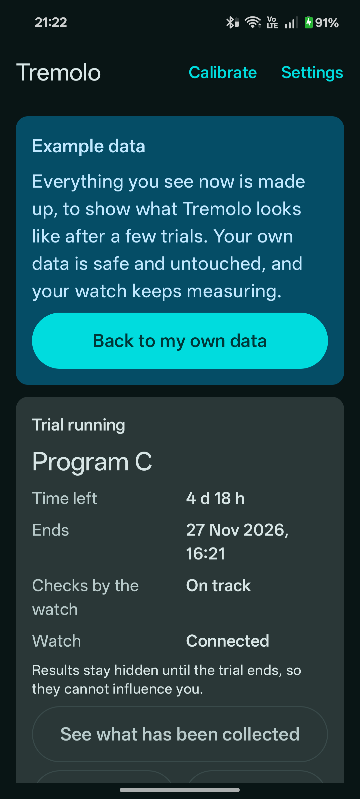
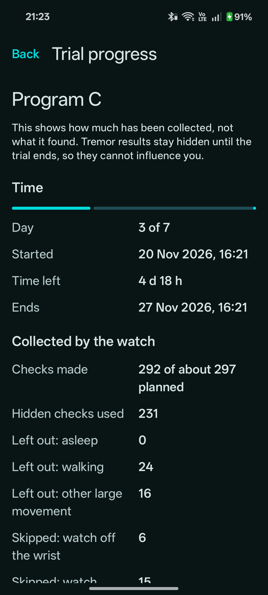
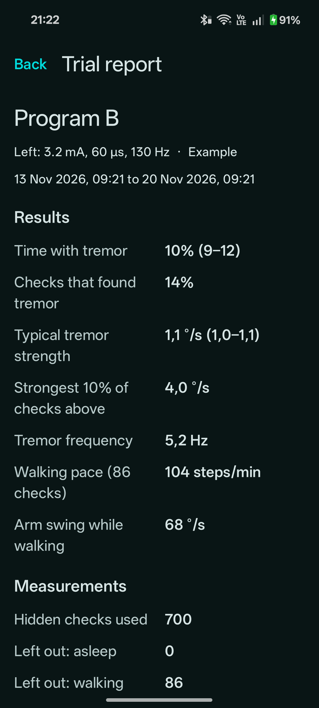
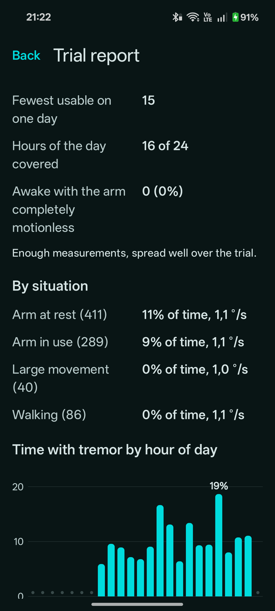
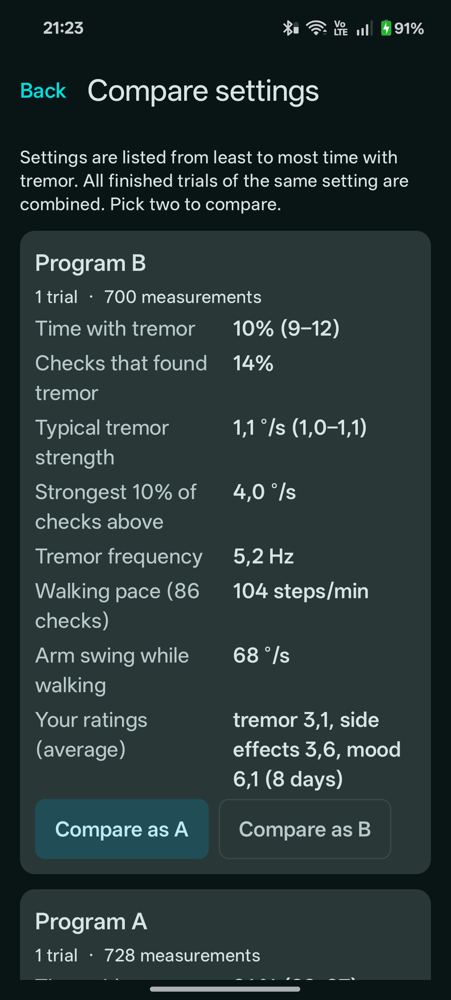

# Tremolo

Tremolo measures arm and hand tremor with a smartwatch, so that people with a deep brain
stimulation (DBS) implant can compare their programs and settings with numbers instead of
impressions.

It is an Android phone app with a companion Wear OS app. The watch takes short recordings of
wrist movement at random moments the wearer cannot predict. The phone analyses them and shows,
once a trial is over, how much tremor there was with each setting.

> **Tremolo is not a medical device.** The method has not been clinically validated. Change
> stimulation only as your clinician allows, and discuss any results with them.

## Screenshots

These show the example data built into the app (Settings → Show an example), not a real person's results.

<p>
  
  
  
  
  
</p>

## Why

Someone with DBS for dystonia, essential tremor or Parkinson's disease often has several
programs to choose from. Judging which one works best is hard: tremor varies through the day,
and knowing which program is active colours how you feel about it. Tremolo tries to remove
both problems:

- **Hidden, random measuring.** During a trial the watch gives no sign of when it measures.
- **Blinded results.** While a trial runs the phone shows only how much has been collected,
  never what was found. Results appear when the trial ends.
- **Like-for-like comparison.** Recordings made while walking, in large movement or asleep are
  left out, and the app warns when two settings were measured under different circumstances.

## What it does

**Trials and plans**
- A trial measures one DBS setting for a number of hours or days.
- A plan runs several settings in a random order, with repeats and a settling-in period after
  each switch. Setting names can be hidden behind letters until the plan is finished.
- A progress screen shows what a running trial has collected, day by day, without results.
- The phone notifies you when the watch has stopped sending measurements.

**Results**
- Time with tremor, tremor strength and tremor frequency, each with a confidence interval.
- Breakdown by hour of the day, by day, and by rest versus activity.
- A data-quality verdict for every trial.
- Comparison of settings, with a check on whether the comparison is fair.
- A plain-language summary for a clinician and a technical report for a DBS programmer, as
  PDF, plus the raw numbers as CSV.

**What you can add yourself**
- A daily rating of tremor, side effects and mood.
- Events such as medication, caffeine, stress or poor sleep, from the phone, a home-screen
  widget, or the watch (app, tile and complication).
- Medication reminders.
- Guided tests: rest and posture tests on the watch; tapping, spiral drawing and speech on the
  phone.
- Sleep times from Health Connect, used to leave out measurements taken while asleep.

**Making it fit you**
- An example with made-up trials, to see what the results look like before collecting your own.
- Calibration with labelled recordings teaches the analysis your own tremor frequency.
- Three measuring paces, from about 4 to about 15 checks an hour.
- English and Dutch.

## Privacy

Everything stays on your phone. There is no account, no server and no analytics. Data leaves
the phone only when you share a report or save a backup yourself.

## How the measuring works

1. The watch records 20 seconds of gyroscope and accelerometer data at 50 Hz.
2. The phone computes a power spectrum and looks for a sustained rhythm in the 3–12 Hz band
   (or your own calibrated range).
3. Each recording is labelled as rest, activity, walking or large movement. Only rest and
   activity count towards the results.
4. Trials are summarised with bootstrap confidence intervals, and two settings are compared
   only when each has at least 30 usable recordings.

The watch only records and sends. All analysis happens on the phone, so recordings can be
re-analysed when the method improves.

## Requirements

- An Android phone with Android 8.0 or newer.
- A Wear OS watch with Wear OS 3 or newer, with a gyroscope. Development and testing happen on
  a Pixel Watch.
- On the watch, Tremolo must be allowed to set alarms (Settings → Apps → Special app access →
  Alarms & reminders). Without it a dozing watch makes far fewer checks than planned. The
  watch app asks for this when it is missing.

## Building

The project is a standard Gradle build with three modules:

| Module    | What it is                                                          |
|-----------|---------------------------------------------------------------------|
| `:shared` | Plain Kotlin: signal processing, phone–watch protocol, statistics, translations |
| `:wear`   | The Wear OS app                                                     |
| `:app`    | The phone app                                                       |

You need JDK 17 or newer (the one bundled with Android Studio works) and the Android SDK with
platform 36.

```sh
./gradlew :shared:test                              # unit tests
./gradlew :app:assembleDebug :wear:assembleDebug    # both apps
```

Install `app/build/outputs/apk/debug/app-debug.apk` on the phone and
`wear/build/outputs/apk/debug/wear-debug.apk` on the watch. Both apps share one application
id and must be signed with the same key, or the phone and watch cannot talk to each other.

Translations live in `shared/src/main/resources/i18n/`, one tab-separated file per language,
keyed by the English text.

## Status

Tremolo is an early, personal project (version 0.1.0), built by someone with DBS for their own
use and in the hope that it helps others. It works end to end, but it has been tested by one
person on one phone and one watch. Expect rough edges, and treat the numbers as an aid to a
conversation with your clinician, not as a diagnosis.

No licence has been chosen yet, so for now all rights are reserved.
